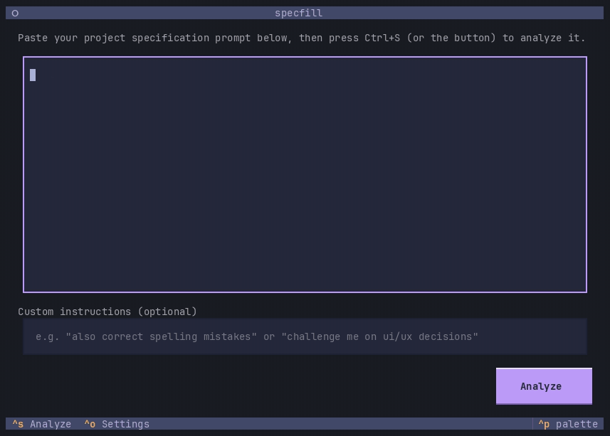

# specfill

Fills the gaps in your project specification prompts: as an interactive TUI,
or as a skill inside Claude Code, Codex, and other coding agents.



You paste a long project specification prompt that you intend to hand to a
coding agent, or load it from a file. An LLM agent researches the topic with
model-native web search and finds the aspects that are underspecified enough
that the coding agent would have to guess. It then interviews you about them in
plan-mode style: one question at a time, with concrete arrow-key options,
multi-select where it makes sense, a free-text "Other" option, and skipping.
Questions come in adaptive rounds and match the language of your prompt. The
interview continues until the specification is complete, or until you press
*Finish now*.

The result is your original prompt with the newly acquired information woven
in, faithfully preserving your style and structure. If an answer contradicts
the original prompt, the latest answer wins. Decisions you left unresolved stay
exactly as ambiguous as you wrote them; nothing is invented.

## How is this different from plan mode?

Plan modes, as implemented in common coding agent CLIs, are less thorough and
don't explicitly look for gaps in your specification. They produce a plan for
the task at hand, but that plan can hardly be used to define the original
project specification, which can serve as a valuable documentation artifact on
its own. specfill borrows the question UX from plan mode, but its output is the
specification itself: complete, in your own words, and reusable.

## Installation

Requires Python ≥ 3.12 on macOS or Linux. Install as a
[uv tool](https://docs.astral.sh/uv/guides/tools/):

```sh
uv tool install specfill        # from a checkout: uv tool install .
```

On first launch, a configuration wizard collects your provider preset
(**OpenAI API**, **OpenAI subscription**, **OpenAI-compatible**, **Anthropic**,
or **Google**), model identifier, reasoning effort, API key, and an optional
custom base URL. The
OpenAI subscription option reuses a Codex login from `~/.codex/auth.json`; run
`codex login` first. Other API keys are stored in the system keyring. If no
keyring backend is available, they fall back to the config file (chmod 600).

Prefer to stay inside your coding agent? Install the
[agent skill](#agent-skill) instead; it needs no configuration.

## Usage

```sh
specfill                  # paste your prompt into the editor
specfill my-prompt.md     # or prefill it from a file
```

Flow:

1. **Paste** your project specification prompt and press `Ctrl+S` to analyze
   it. The agent researches with web search before asking questions, and the
   progress is shown live. If your model has no native search, or search fails
   during a session, specfill warns and continues without it.
2. **Answer** the questions. Use the arrow keys plus `Enter` or `Space` to
   select, or type into *Other / details…* for a free-text answer.
   `Ctrl+N` answers, `Ctrl+K` skips, `Ctrl+F` finishes early.
3. **The result** streams into a scrollable preview. Press `c` to copy it to
   the clipboard (with confirmation), `r` to regenerate it from the same
   answers, and `p` to quit and print the revised prompt, and only that,
   to stdout.

Skipped questions are treated as "implementer's discretion" and are never
asked again.

## Agent skill

specfill also ships as an [Agent Skill](https://agentskills.io) for Claude
Code, Codex, and other coding agents. The skill runs the same interview inside
the agent you already use, with that agent's model, web search, and
multiple-choice question UI, so it needs no API key or configuration. It also
reads the codebase your prompt refers to instead of asking you about it.

Install it in **Claude Code**:

```
/plugin marketplace add kklemon/specfill
/plugin install specfill@specfill
```

On Claude Code 2.1.275 or later,
`/plugin install specfill --marketplace kklemon/specfill` does both in one step.

In **Codex**:

```sh
codex plugin marketplace add kklemon/specfill
codex plugin add specfill@specfill
```

In **Cursor, Gemini CLI, GitHub Copilot, OpenCode**, and
[many other agents](https://github.com/vercel-labs/skills), use the skills CLI,
which also covers Claude Code and Codex:

```sh
npx skills add kklemon/specfill
```

Then point it at your prompt:

```
/specfill my-prompt.md                   # Claude Code (full name: /specfill:specfill)
$specfill my-prompt.md                   # Codex
use specfill to refine my-prompt.md      # any agent
```

Anything you add after the file, such as "challenge me on UI/UX decisions",
acts as custom instructions. Agents also pick the skill on their own when you
ask them to refine or complete a project prompt.

How the skill differs from the TUI:

- Questions use the agent's own question UI where it has one, such as Claude
  Code's. Codex offers its question UI only in Plan mode, so in Default mode,
  and in agents without one, the questions arrive as a plain message that you
  answer in text, for example `1b, 2a+c, 3: free text, 4 skip`.
- Answer `skip` to leave a question open, or `finish` to end the interview and
  get the refined prompt.
- A prompt read from a file is revised in place with targeted edits, so you
  can review the diff. A pasted prompt comes back as the agent's reply; in
  Claude Code, `/copy` puts it on the clipboard.
- The interviewer and rewriter follow the same rules as the TUI, but the
  model, reasoning effort, and web search are the agent's. The TUI's
  configuration below does not apply.

## Configuration

These settings apply to the TUI. They live in
`~/.config/specfill/config.toml` (honors `$XDG_CONFIG_HOME`) and can be edited
in three ways: the in-app settings screen (`Ctrl+O` on the paste screen), the
CLI, or the file itself.

```sh
specfill config show                    # current configuration
specfill config path                    # config file location
specfill config set provider anthropic  # provider | model | reasoning-effort | base-url | web-search
specfill config set provider openai-subscription
specfill config set model claude-opus-5
specfill config set reasoning-effort high   # default | none | minimal | low | medium | high | xhigh
specfill config set-key                 # store the API key (hidden prompt)
```

`reasoning-effort` controls how hard the model thinks before it answers.
`default` leaves the provider's own behavior untouched. OpenAI-based providers
receive the value verbatim as `reasoning_effort`; for Anthropic and Google it
is translated to the closest supported thinking level (adaptive thinking plus
output effort on Claude, the thinking level on Gemini). Levels a model does not
support are reported by the provider as a request error, so pick another one
if that happens.

Every setting can also be overridden per invocation via `SPECFILL_*`
environment variables, for example `SPECFILL_MODEL` or
`SPECFILL_WEB_SEARCH=false`. API keys resolve from the keyring first, then the
config file or `$SPECFILL_API_KEY`, then the provider's conventional variable
(`OPENAI_API_KEY`, `ANTHROPIC_API_KEY`, `GOOGLE_API_KEY`).

`openai-subscription` uses the OAuth credentials maintained by Codex and sends
Responses requests to `https://chatgpt.com/backend-api/codex`. These requests
count against the limits of the signed-in ChatGPT plan rather than API billing.
This direct backend is not documented as a stable public API, so it may require
maintenance when Codex authentication or request requirements change.

LLM inference is provider-agnostic via [Pydantic AI](https://ai.pydantic.dev/)
(default model: OpenAI GPT-5.6 Sol). The UI is built with
[Textual](https://textual.textualize.io/).

## Development

```sh
uv sync
uv run pytest                       # offline tests (scripted models, no network)
claude plugin validate --strict .   # plugin, marketplace, and skill manifests
```

The skill lives in `skills/specfill/SKILL.md` and mirrors the TUI's prompts in
`specfill/agents.py`; the tests fail when the rewriter rules or the round cap
drift apart. See [docs/publishing.md](docs/publishing.md) for releasing both.
